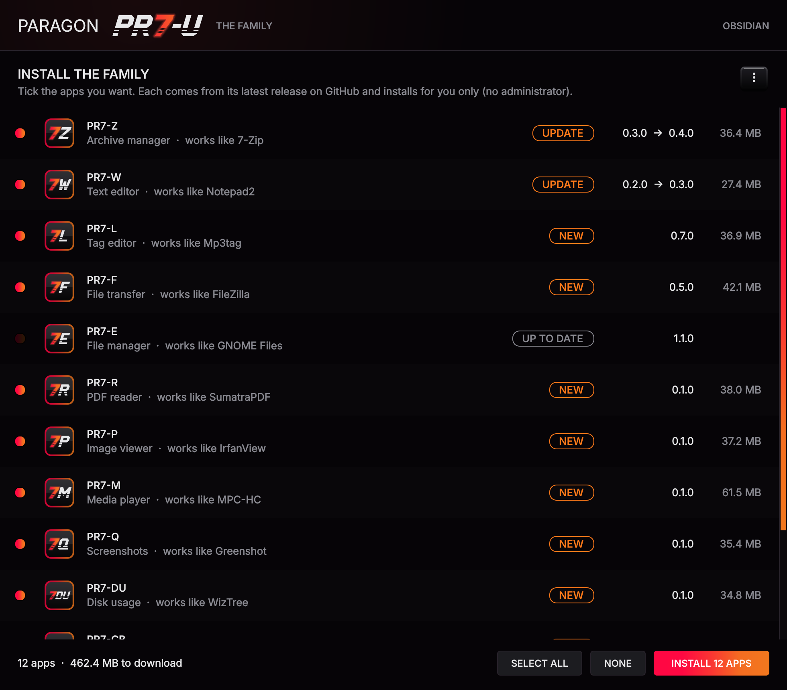

# Paragon PR7-U

The one download for the whole Paragon PR7 family: PR7-U installs, updates and removes the family's apps, each from its
own latest GitHub release, in the family look. Python and PySide6.



| App | What it is | Works like |
|---|---|---|
| PR7-Z | Archive manager | 7-Zip |
| PR7-W | Text editor | Notepad2 |
| PR7-L | Tag editor | Mp3tag |
| PR7-F | File transfer | FileZilla |
| PR7-E | File manager | GNOME Files |
| PR7-R | PDF reader | SumatraPDF |
| PR7-P | Image viewer | IrfanView |
| PR7-M | Media player | MPC-HC |
| PR7-Q | Screenshots | Greenshot |
| PR7-DU | Disk usage | WizTree |
| PR7-CB | Clipboard history | Ditto |
| PR7-IS | File search | Everything |
| PR7-PM | Password manager | KeePassXC |

## How it works

- Run `PR7-U-Setup-<version>.exe` (per user, no administrator). Its last page opens PR7-U on **Install the family**:
  everything is ticked; untick what you don't want, then INSTALL.
- Each app's own installer is downloaded from its release and run silently, so it installs exactly as by hand:
  Explorer menu, Open with, start-up and other ticked tasks. Updates keep the choices you made before. A first
  install of PR7-W leaves out "Replace Windows Notepad" (it needs administrator permission); turn it on in PR7-W.
- Afterwards PR7-U is **Your Paragon apps**: OPEN, UPDATE or INSTALL per app, release notes, uninstall, UPDATE ALL.
  Each app also still updates itself, and each is listed in Windows' Installed apps on its own.
- Only the app's name goes to GitHub (the public releases address); nothing about you.

## Command line

```
PR7-U.exe --choose                     open on Install the family
PR7-U.exe --install all|Z,W,...        install or update without a window (exit code 1 if one failed)
PR7-U.exe --uninstall all|Z,W,...      uninstall without a window
PR7-U.exe --list OUT.json              what's installed and each app's newest release
```

## Building

`pip install -r requirements-dev.txt`, `python -m pytest`, `pyinstaller pr7u.spec`, then Inno Setup 6 on
`installer/pr7u.iss`. CI does all of it on Windows, then installs the real family with the installed PR7-U and
removes it again.
